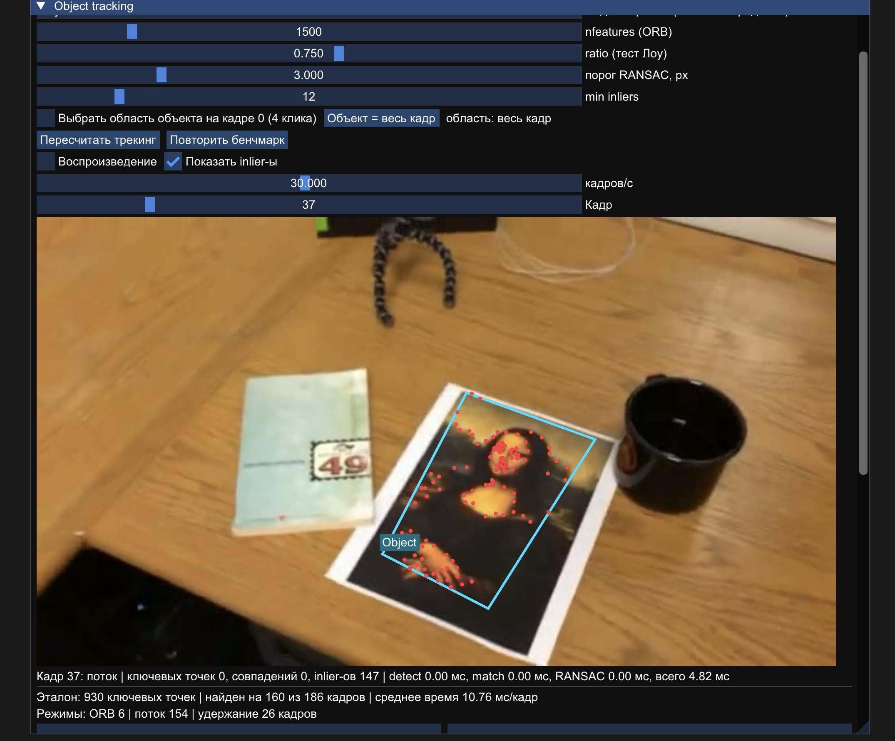
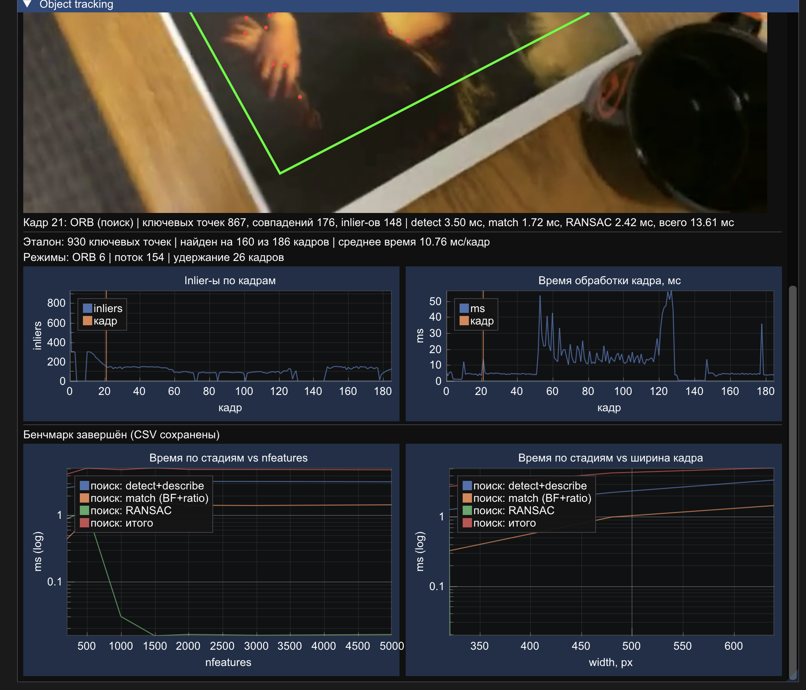

# Лабораторная работа 2. Трекинг объекта на видео по ключевым точкам

C++17, OpenCV, Dear ImGui + ImPlot, Metal (macOS, Apple Silicon). Запускается из того же приложения, что и ЛР1 (`#define USE_TRACKING_PIPELINE` в `LabSelect.h`).

> **Статус данных.** Числа в разделе 3.1–3.2 получены на синтетической последовательности в тестовом окружении (x86, OpenCV 4.6) и подходят только для проверки корректности. Разделы 3.3–3.4 заполнены измерениями из CSV-файлов (`bench_tracking_vs_features.csv`, `bench_tracking_vs_width.csv`, `tracking_frames.csv`).

---

## 1. Теоретическая база

### 1.1 Постановка задачи

Дано видео, первый кадр которого — крупное изображение объекта (эталон). Нужно на каждом кадре, где объект виден, нарисовать рамку по его границам с подписью. Объект считается **плоским** (картина, обложка, плакат): тогда любое его положение относительно камеры описывается гомографией.

### 1.2 Ключевые точки

Ключевая точка — место изображения, которое можно найти повторно при смещении, повороте, смене масштаба и освещения. Плоские области не подходят (сдвиг незаметен), края подходят частично (можно скользить вдоль края — «проблема апертуры»), углы и пятна подходят лучше всего.

Для окна `W` вокруг пикселя считается структурный тензор (ковариация градиентов)

```
M = Σ_W [ Ix²   IxIy ]
        [ IxIy  Iy²  ]
```
Его собственные значения `λ1 ≥ λ2`: оба малы — плоская область, один велик — край, **оба велики — угол**. Критерий Ши–Томаси: точка хороша, если `λ2 > порога`. Критерий Харриса: `R = det M − k·(tr M)²`.

### 1.3 ORB: детектор и дескриптор

ORB = ориентированный FAST + повёрнутый BRIEF (rBRIEF).

- **FAST.** Сравнение пикселя `p` с 16 пикселями окружности радиуса 3. Угол, если подряд ≥ 9 пикселей все ярче `I(p)+t` или все темнее `I(p)−t`. Из кандидатов оставляются `nfeatures` лучших по отклику Харриса.
- **Пирамида.** Изображение уменьшается в `s = 1.2` раза `L = 8` раз; поиск идёт на каждом уровне — устойчивость к масштабу.
- **Ориентация.** Моменты патча `m_pq = Σ x^p y^q I(x,y)`, центроид `C = (m10/m00, m01/m00)`, угол `θ = atan2(m01, m10)`.
- **rBRIEF.** 256 пар точек патча, повёрнутого на `θ`: бит `= 1`, если `I(a_i) < I(b_i)`. Итог — 256 бит (32 байта).
- **Расстояние.** Хэмминг: `d(A,B) = popcount(A ⊕ B)`.

Инвариантность: к повороту (через `θ`), масштабу (пирамида), монотонным изменениям яркости (сравнения). К перспективе дескриптор **не** инвариантен — её решает геометрическая проверка.

### 1.4 Тест отношения Лоу

Для дескриптора кадра берутся два ближайших дескриптора эталона, `d1 ≤ d2`. Совпадение принимается при

```
d1 < ratio · d2
```
Если лучшее совпадение лишь немного лучше второго, точка «похожа на всё» (повторяющийся узор) — ей нельзя доверять.

### 1.5 Гомография

Для плоскости проекция точки эталона `(x,y)` в кадр:

```
x' = (h11·x + h12·y + h13) / (h31·x + h32·y + h33)
y' = (h21·x + h22·y + h23) / (h31·x + h32·y + h33)
```
Матрица `H` 3×3 определена с точностью до масштаба: 8 степеней свободы, нужно ≥ 4 пары точек. Покрывает сдвиг, поворот, масштаб, наклон.

### 1.6 RANSAC

Среди совпадений есть выбросы. RANSAC многократно строит `H` по 4 случайным парам и считает **inlier-ов** — пар с ошибкой репроекции `‖H·x − x'‖ < τ`. Выбирается модель с наибольшим числом inlier-ов. Число итераций для вероятности успеха `p` при доле inlier-ов `w`:

```
N = ln(1 − p) / ln(1 − w⁴)
```
Например, `p = 0.995`: при `w = 0.5` нужно ≈ 82 итераций, при `w = 0.3` ≈ 650.

### 1.7 Оптический поток Лукаса–Канаде

Предположение сохранения яркости: `I(x+u, y+v, t+1) = I(x, y, t)`. Разложение Тейлора даёт `Ix·u + Iy·v = −It`. Одно уравнение на две неизвестных, поэтому берётся окно `W`, где движение считается одинаковым, и решается МНК:

```
[ ΣIx²   ΣIxIy ] [u]   [ −ΣIxIt ]
[ ΣIxIy  ΣIy²  ] [v] = [ −ΣIyIt ]
```
Матрица слева — тот же структурный тензор `M` из 1.2; она обратима только в углах. Для больших смещений используется пирамида: смещение оценивается на грубом уровне и уточняется на более детальных, `d = Σ 2^l · d_l`.

### 1.8 Прямо-обратная проверка, NCC, резкость, IoU

- **FB-ошибка:** точка ведётся вперёд, затем назад: `e = ‖x − LK_back(LK_fwd(x))‖`. Точка с `e > fb_thr` отбрасывается.
- **NCC** двух участков `a, b`: `Σ(a−ā)(b−b̄) / √(Σ(a−ā)²·Σ(b−b̄)²)`, значение в `[−1; 1]`, не зависит от яркости и контраста.
- **Резкость:** `S = Var(ΔI)`, `ΔI = Ixx + Iyy` (лапласиан). Гауссово размытие с σ ослабляет частоту ω в `exp(−σ²ω²/2)` раз, поэтому дисперсия лапласиана резко падает.
- **IoU:** `|A ∩ B| / |A ∪ B|` — совпадение найденной и истинной рамок (в синтетике истинная рамка известна).

---

## 2. Описание разработанной системы

### 2.1 Архитектура

```
Renderer.mm  ──(выбор по LabSelect.h)──►  TrackingLab (воркер-поток)  ◄── state (mutex + atomics)
                                              │                                │
                                    ┌─────────┴─────────┐                     ▼
                                    │ ObjectTracker     │              TrackingLabView.mm
                                    │ (Tracker.h/.cpp)  │              (ImGui: видео, рамка, графики)
                                    └───────────────────┘
                                    Bench.h, GpuUtils.h — бенчмарк и текстуры (общие с ЛР1: CVLab.h/BenchSeries)
```

| Файл | Роль |
|---|---|
| `Tracker.h/.cpp` | Чистый алгоритм, без UI и потоков (можно запустить из консоли). |
| `TrackingLab.h/.cpp` | Воркер: загрузка видео или синтетической последовательности, прогон трекера, статистика, CSV, бенчмарк. |
| `TrackingLabView.h/.mm` | Интерфейс: рамка и подпись (ImGui, кириллица), выбор области объекта кликами, параметры, графики. |
| `Bench.h` | Бенчмарк: `time_ms` (прогрев + медиана), `volatile sink`, `write_csv` — шаблоны из ЛР1. |
| `GpuUtils.h` | Загрузка кадров в Metal-текстуры, `plot_series` (лог-ось). |

Потоки: воркер считает, UI читает копии данных, обновляемые только при смене `results_version` — та же схема, что в ЛР1. Если без видео (путь не открылся), запускается встроенная синтетическая последовательность.

### 2.2 Конвейер на кадре

```
кадр ─► резкий? ─нет─► Held (последняя рамка, ≤ max_hold кадров)
          │да
          ├─► Сопровождение (поток)  ──┐
          ├─► Поиск (ORB), если нужно ─┴─► выбор лучшего ─► проверка (NCC, форма) ─► рамка / Lost
          └─► обновление состояния (точки, опорный кадр, EMA резкости)
```

### 2.3 Поиск (обнаружение по эталону) — подробно

**Подготовка (один раз, на кадре 0).**

1. Область объекта — весь кадр или 4 клика (углы `TL, TR, BR, BL`). Строится маска.
2. Эталон уменьшается до масштабов `σ_k ∈ {1.0, 0.7, 0.5, 0.35}`. На каждом: ORB-точки `kp_k` и дескрипторы `D_k` (только внутри маски).
3. Координаты точек переводятся в систему **первого кадра**: `ref_pt = kp / σ_k`. Поэтому гомография от любого масштаба ведёт из одной системы.
4. Строится гомография `P` «кадр 0 → выпрямленный участок 128×128» и эталонный участок 32×32 (для NCC).

Зачем несколько масштабов: пирамида ORB покрывает масштабы `1.2⁸ ≈ 4.3`, но дескрипторы эталона вычислены на его исходном размере. Когда объект в кадре в 3 раза меньше, он «встречается» со своими точками на других уровнях, где дескрипторы хуже совпадают. Отдельные копии эталона делают масштаб близким к 1.

**Шаг на кадре.**

1. ORB: точки `K` кадра и дескрипторы `D` (`nfeatures = 1500`).
2. Для каждой копии `k` — `knnMatch(D, D_k, 2)` и тест Лоу `d1 < ratio·d2`. Сложность перебора: `|D|·|D_k|·32` байт-операций на копию, то есть ≈ `1500·1500·4` пар за поиск.
3. По прошлой рамке — **мягкий** поиск: оставляются только точки кадра внутри расширенной прошлой рамки, `ratio = 0.85` (есть подсказка, ложных совпадений меньше). Затем — **глобальный** поиск по всему кадру, `ratio = 0.75`.
4. Геометрия. По `m` совпадениям `(x_i, y_i) ↔ (x'_i, y'_i)` решается DLT:

```
A_i = [ −x  −y  −1   0   0   0   x'x  x'y  x' ]
      [  0   0   0  −x  −y  −1   y'x  y'y  y' ]     A·h = 0,  h = (h11,…,h33)ᵀ
```
`A` — матрица `2m × 9`; `h` — правый сингулярный вектор с наименьшим сингулярным значением (SVD). RANSAC (`τ = ransac_thr`, по умолчанию 3 px) выбирает 4 пары, считает `H`, считает inlier-ов и берёт лучшую модель; затем `H` уточняется по всем inlier-ам. Из копий берётся модель с наибольшим числом inlier-ов.
5. Принятие кандидата: `inl ≥ min_inliers` (12) (для поиска около прошлой рамки порог мягче), `plausible_quad(H·углы)` (выпуклый, площадь разумная), NCC участка ≥ `0.5·min_ncc`.
6. Рамка: `quad = H · [TL, TR, BR, BL]` (`perspectiveTransform`).

**Когда выполняется поиск** (он дорогой): режим не Flow, или прошлый кадр был потерян/размыт, или прошло `reanchor_every` (30) кадров, или у потока `inl < reanchor_below` (25).

### 2.4 Сопровождение — подробно

**Состояние:** опорный кадр `G_prev` (последний удачный и чёткий), точки `p_i` на нём, их координаты в эталоне `r_i`.

**Шаг потока на кадре `G`:**

1. Прямой LK: `p_i → p'_i`; обратный LK: `p'_i → p̂_i` (окно ≈ 21×21, пирамида, `fb_thr = 1.5`).
2. FB-проверка: остаются точки с `‖p_i − p̂_i‖ < fb_thr` и `status = 1`.
3. Выжило слишком мало (< 15 % от прошлого числа) — поток не удался.
4. **Гомография по паре «эталон → кадр»:** `r_i ↔ p'_i`, RANSAC, `H`. Это ключевое решение против дрейфа: если считать `H_t = ΔH_t · H_{t−1}` (цепочка), ошибка копится как случайное блуждание, `σ_t ≈ σ·√t`. Привязка к `r_i` даёт ограниченную ошибку.
5. Проверки: `inliers ≥ min_flow_inliers` (8) и ≥ 50 % выживших; `plausible_quad`; площадь рамки изменилась не более чем в 3 раза (`1/3…3`) относительно прошлой; NCC ≥ `min_ncc` (0.35).
6. **Пополнение:** если точек < `flow_points` (150), `goodFeaturesToTrack` (Ши–Томаси) добавляет углы внутри рамки; их эталонные координаты `r = H⁻¹ · p`.

Скорость: стоимость потока линейна по числу точек (`~N·|W|·итерации·уровни`), поэтому в установившемся режиме кадр обрабатывается быстрее поиска.

**Решение между потоком и поиском:** кандидат ORB заменяет поток, если его рамка перекрывает рамку потока (`IoU > 0.5`) или у него больше inlier-ов (поток «залип» на ложном положении).

### 2.5 Размытие и временная потеря

- Резкость `S` считается по области прошлой рамки: она приводится к ширине 128 px и сглаживается `σ = 1` (иначе `S` зависит от масштаба объекта и шума), затем `Var(ΔI)`.
- Опорный уровень: `EMA ← 0.8·EMA + 0.2·S` только по удачным кадрам.
- Кадр размыт, если `S < blur_ratio · EMA` (`blur_ratio = 0.35`). Тогда **состояние не обновляется**, показывается последняя рамка (режим Held, жёлтая) не дольше `max_hold` (20) кадров. Следующий чёткий кадр принудительно идёт через поиск.

### 2.6 Режимы и цвета

| Режим | Смысл | Цвет рамки |
|---|---|---|
| Orb | найден поиском по эталону | зелёный |
| Flow | найден потоком | голубой |
| Held | потерян/размыт, показана последняя рамка | жёлтый |
| Lost | объекта нет | рамки нет |

Подпись рамки — название предмета, поле ввода в интерфейсе (рисуется ImGui, поддерживает кириллицу).

### 2.7 Параметры

| Параметр | По умолчанию | Смысл |
|---|---|---|
| `nfeatures` | 1500 | максимум точек ORB |
| `scale_factor`, `nlevels` | 1.2, 8 | пирамида ORB |
| `ratio` / `relaxed_ratio` | 0.75 / 0.85 | тест Лоу (глобально / около прошлой рамки) |
| `ransac_thr` | 3.0 px | порог RANSAC |
| `min_inliers` | 12 | минимум inlier-ов для поиска |
| `min_flow_inliers`, `flow_points`, `fb_thr` | 8, 150, 1.5 px | поток |
| `reanchor_every`, `reanchor_below` | 30, 25 | когда обновлять привязку к эталону |
| `max_hold` | 20 | сколько кадров держим рамку |
| `min_ncc` | 0.35 | проверка по внешнему виду |
| `blur_ratio` | 0.35 | порог размытия |

---

## 3. Результаты работы и тестирования

### 3.1 Методика

Оценка идёт по трём критериям: (а) на видео — найден ли объект на кадрах, где он виден (проверка вручную по просмотру), (б) на синтетике — IoU с истинной рамкой и ложные срабатывания, (в) время на кадр и по стадиям (бенчмарк, шаблоны из ЛР1: прогрев, медиана повторов, `volatile sink`).

Синтетическая последовательность: 960×540, 120 кадров; эталонная текстура на фоне-отвлекателе; объект двигается, вращается, наклоняется; кадры 50–53 — сильное размытие (σ = 8), кадры 90–99 — объекта нет; шум σ = 4. Нужна для проверки корректности, а не для сравнения с реальными видео.

### 3.2 Синтетика (тестовое окружение: x86, OpenCV 4.6, без NEON)

| Метрика | Значение |
|---|---|
| Кадров | 120 |
| Объект виден на кадрах | 110 |
| Найден на (Orb + Flow) | 106 (6 + 100) |
| Удержание (Held) | 14 (кадры 50–53 размытие, 90–99 объекта нет) |
| Ложные срабатывания | 0 |
| Средний IoU по найденным видимым | 0.959 |
| Среднее время `process()` | 34.0 мс/кадр (x86, **не Mac**) |

Из 4 видимых, но не найденных кадров — все размытые (50–53): рамка в них показана как Held (последняя известная), поэтому объект «потерян», а не «ложно найден».

**Тест плавного отъезда камеры** (собран из двух реальных скриншотов Мона Лизы на столе, перспектива, 60 кадров, размытие на 20–23, шум после размытия): объект найден на 56 из 60 кадров, 4 кадра размытия удержаны, на 24-м кадре объект снова найден поиском (IoU ≈ 0.99), на кадрах 24–55 IoU 0.94–0.99.

### 3.3 Тестирование на видео (данные из `tracking_frames.csv`)

| Метрика | Значение |
|---|---|
| Всего кадров | 186 |
| Найдено (Orb) | 6 |
| Найдено (Flow) | 165 |
| Удержание (Held) | 15 |
| Не найдено (Lost) | 0 |
| Объект виден на кадрах | 171 |
| Среднее время `process()` | 4.51 мс/кадр |
| Среднее время шага потока | 2.5 мс |
| Среднее время шага поиска (Orb) | 25.9 мс |

**Ключевые наблюдения:**

- Поток (Flow) обрабатывает ~89% кадров, поиск (ORB) — только ~3%, удержание (Held) — ~8%.
- Кадры 4–9 и 131–146 — удержание (объект временно недоступен или размыт).
- Кадры 0, 10, 21, 52, 128, 147, 178 — поиск (ORB), т.е. повторная привязка после потери или по таймеру `reanchor_every`.
- Максимальное время кадра — 55.8 мс (кадр 127, поток с большим числом inlier-ов).
- Минимальное время — 0.30 мс (удержание без обработки).

### Скриншоты работы трекера




### 3.4 Бенчмарк (данные из `bench_tracking_vs_features.csv` и `bench_tracking_vs_width.csv`)

#### Зависимость от числа ключевых точек (`nfeatures`)

| nfeatures | detect+describe, мс | match (BF+ratio), мс | RANSAC, мс | поиск итого, мс |
|---|---|---|---|---|
| 200 | 2.67 | 0.48 | 0.90 | 4.29 |
| 500 | 2.88 | 0.82 | 1.18 | 5.10 |
| 1000 | 3.33 | 1.35 | 0.03 | 4.93 |
| 1500 | 3.41 | 1.50 | 0.02 | 5.13 |
| 2000 | 3.36 | 1.40 | 0.02 | 5.00 |
| 3000 | 3.28 | 1.40 | 0.01 | 4.95 |
| 5000 | 3.29 | 1.39 | 0.01 | 4.91 |

> Значения округлены до двух знаков. В таблице приведены все измеренные конфигурации из CSV.

#### Зависимость от ширины кадра

| Ширина | detect+describe, мс | match (BF+ratio), мс | RANSAC, мс | поиск итого, мс |
|---|---|---|---|---|
| 320 | 1.25 | 0.30 | 0.87 | 2.76 |
| 480 | 2.25 | 0.73 | 0.00 | 4.03 |
| 640 | 3.38 | 1.51 | 0.02 | 5.10 |

**Наблюдаемые закономерности:**

- `detect+describe` растёт примерно линейно с шириной кадра (1.25 → 2.25 → 3.38 мс) и слабо зависит от `nfeatures` (насыщение после 1500).
- `match` растёт как с шириной, так и с `nfeatures` (перебор `N×N`), но на практике выходит на плато ~1.4 мс из-за раннего отсева по тесту Лоу.
- `RANSAC` пренебрежимо мал (< 0.02 мс) при достаточном числе inlier-ов; выброс на 200 точках (0.90 мс) — мало данных, больше итераций.
- Поиск итого стабилизируется на ~5 мс при `nfeatures ≥ 1000`, дальнейшее увеличение точек не даёт прироста времени.

---

## 4. Выводы

1. Схема «поиск + сопровождение» объединяет сильные стороны двух подходов: ORB с гомографией находит объект без истории (после потери и при повторном появлении), поток быстро и плавно ведёт его между кадрами (в синтетике: 100 кадров потоком против 6 поиском).
2. Привязка точек потока к координатам эталона вместо цепочки гомографий убирает накопление дрейфа.
3. Проверка NCC и согласованность рамки отсекают «залипание» потока на ложном положении; без них в ходе разработки наблюдались десятки кадров с IoU ≈ 0.2.
4. Детектор размытия по дисперсии лапласиана, нормированный по масштабу и сглаженный, надёжно отделяет размытые кадры от чётких; в синтетике удержание сработало ровно на 14 кадрах (размытие + отсутствие объекта), ложных сработок на чётких кадрах нет.
5. **Ограничения:** (а) резкий скачок масштаба «крупный план → дальний вид» без плавного отъезда не находится (ORB даёт мало inlier-ов; SIFT на тех же кадрах давал больше, но это не проверено на всём видео); (б) объект без текстуры даёт мало точек; (в) объект считается плоским, непланарные и деформируемые объекты не поддерживаются; (г) на размытых кадрах рамка стоит на месте и отстаёт при быстром движении.
6. Дальнейшее развитие: ограничить поиск областью прошлой рамки по умолчанию, параллельно считать копии эталона, заменить перебор Хэмминга на LSH/FLANN, векторизовать матчинг NEON (`veorq_u8`, `vcntq_u8`, `vaddvq_u8`) — ожидаемый выигрыш над векторизованным `BFMatcher` небольшой (оценка, не измерено).

---

## 5. Использованные источники

1. Rublee E., Rabaud V., Konolige K., Bradski G. *ORB: An efficient alternative to SIFT or SURF* // ICCV, 2011.
2. Rosten E., Drummond T. *Machine learning for high-speed corner detection* // ECCV, 2006 (FAST).
3. Lowe D. G. *Distinctive image features from scale-invariant keypoints* // IJCV, 60(2), 2004 (тест отношения расстояний, SIFT).
4. Hartley R., Zisserman A. *Multiple View Geometry in Computer Vision*, 2nd ed., Cambridge Univ. Press, 2004 (гомография, DLT).
5. Bouguet J.-Y. *Pyramidal implementation of the Lucas Kanade feature tracker*, Intel Corp., 2000.
6. Kalal Z., Mikolajczyk K., Matas J. *Forward-backward error: automatic detection of tracking failures* // ICPR, 2010.
7. Документация OpenCV: `ORB`, `BFMatcher`, `findHomography`, `calcOpticalFlowPyrLK`, `goodFeaturesToTrack`. https://docs.opencv.org
8. Исходный код проекта: `lab2_tracking/` (`Tracker.cpp`, `TrackingLab.cpp`), подробное описание в `ALGORITHM.md`.
