# Отчёт по ЛР3: SR-inpainting на диффузионной модели SUPIR — улучшение фрагмента изображения по маске

**Вариант:** ☒ вариант 1 — ноутбук `lab3_supir_mask.ipynb` (чистый Python) ☐ вариант 2 — проект `lab3_supir_mask` (Python + C++/SIMD)  
Числа в этом отчёте — из **серверного** прогона (`SUPIR_experiments-server.ipynb`); все `.png` и `results-2.csv` лежат в этой же папке. Эталонные изображения: `images-2.jpg`, `images-3.jpg`.

> Правила заполнения: в отчёт попадают **только** результаты реального прогона SUPIR (`USE_FAKE=False`, без `--fake_model`). Каждое число подписано источником (файл, команда). Гипотезы отделены от результатов.

---

## 1. Постановка задачи

Диффузионная модель восстановления SUPIR улучшает изображение целиком. Требуется изменить процесс сэмплирования так, чтобы улучшалась только область, заданная бинарной маской (массив с разрешением входа), а остальное изображение сохранялось. Исходники SUPIR не правятся, переобучения нет.

Входные данные: изображение LQ (низкого качества, увеличенное до размера HR), маска `H×W`. Выход: изображение, в котором область маски улучшена, а вне маски совпадает со входом.

Критерии (из задания): качество восстановления (PSNR/LPIPS/CLIP-IQA), время на кадр, работа на платформах Mac и NVIDIA 20 ГБ, чистый Python (вариант 1).

## 2. Теоретическая база

### 2.1 Диффузионные модели
Прямой процесс: `x_σ = z₀ + σ·ε`, `ε ~ N(0, I)`. Обратный процесс: денойзер `D(x, σ)` в параметризации EDM, шаг Эйлера `d = (x − D)/σ`, `x_next = x + (σ_next − σ)·d`.

### 2.2 Латентные диффузионные модели
Диффузия в латентном пространстве VAE: `H×W×3 → H/8 × W/8 × 4`; латентный пиксель = блок 8×8.

### 2.3 SUPIR
Адаптер (GLVControl, ZeroSFT), устойчивый к деградациям VAE-кодировщик, restoration-guided sampling `D' = D − (D − z_stage1)·(σ/σ_max)^κ`, текстовые подсказки, тайловый сэмплер.

### 2.4 Inpainting диффузионной моделью
RePaint и Blended Diffusion: `x_known(σ) = z_ref + σ·ε_fixed`; `x ← m ⊙ x_gen + (1−m) ⊙ x_known(σ_next)`. SR-inpainting отличается тем, что внутри маски нужно не придумать содержимое, а улучшить входное (условие `control` — латент всего LQ).

### 2.5 Маска в латентном пространстве
Усреднение блоков 8×8 → гауссова растушёвка σ = 1,5 латентного пикселя → [0,1].

### 2.6 Метрики
PSNR (всё / внутри / вне маски), LPIPS (AlexNet, `spatial=True`, среднее по маске), CLIP-IQA (без эталона, по всему изображению). Компромисс «искажение–восприятие».

### 2.7 SIMD `[только проект]`
Не применимо — выбран вариант 1 (чистый Python, ноутбук).

---

## 3. Описание разработанной системы

### 3.1 Что изменено в SUPIR
| Класс | Основа | Добавлено |
|---|---|---|
| `MaskedRestoreEDMSampler` | `RestoreEDMSampler` | подстановка `x ← m·x + (1−m)·(z_ref + σ_next·ε)` после каждого шага и для стартового шума |
| `MaskedTiledRestoreEDMSampler` | `TiledRestoreEDMSampler` | то же после сборки тайлов |

Особые случаи: маска «всё 1» — подстановка пропускается (результат как у обычного SUPIR); «всё 0» — сеть не запускается, возвращается вход; `hard_composite` — жёсткий возврат исходных пикселей вне маски после декодирования.

### 3.2 Сравниваемые методы
| Метод | Описание |
|---|---|
| LQ | вход (бикубическое увеличение), нижняя граница, не требует инференса |
| A | предлагаемый: подстановка внутри сэмплирования (маска применяется на каждом шаге EDM) |
| C | baseline: SUPIR на всём изображении + попиксельная склейка по маске |

### 3.3 Архитектура и поток данных
Вход + маска → `mask_to_latent` → VAE-энкодеры (`z_ref`, `z_stage1`, `control`) → сэмплер EDM с подстановкой → VAE-декодер + цветокоррекция → composite (опция) → выход и метрики.

### 3.4 Состав и платформы
| Параметр | NVIDIA 20 ГБ | Mac (MPS) |
|---|---|---|
| device / dtype | cuda, fp16 / bf16 | mps, fp16 / fp32 |
| min_size / max_side | 1024 / 1024 | 512 / 512 |
| edm_steps | 50 | 20 |
| тайлы VAE (энк./дек.) | 512 / 64 | 256 / 32 |
| тайлы сэмплера / stride | 128 / 64 | 64 / 32 |

Значения — стартовые оценки профиля сервера. Фактически использованный профиль: см. `SUPIR_experiments-server.ipynb` и скриншоты в разделе 9.

**`[только проект]` C++ библиотека:** не применимо (вариант 1).

### 3.5 Среда выполнения
| Что | Значение |
|---|---|
| Запуск | серверный ноутбук `SUPIR_experiments-server.ipynb` |
| ОС / CPU / GPU и видеопамять | сервер, NVIDIA (~20 ГБ VRAM по профилю задания); точные версии — см. скриншоты в разд. 9 |
| Python / PyTorch / CUDA | см. ячейки ноутбука `SUPIR_experiments-server.ipynb` |
| Версия SUPIR (commit), веса (SDXL base 1.0, SUPIR-v0Q/v0F) | см. ноутбук серверного запуска |
| Данные | 2 эталона: `images-2.jpg`, `images-3.jpg` |
| Деградации | `bicubic4x`, `unknown`, `realesrgan` |
| Маски | `ones` (1.0), `zeros` (0.0), `left_half` (0.5), `center` (0.25/0.2539), `circle` (0.1942/0.2539), `combined` (0.1934/0.2002) |
| Метрики | PSNR / LPIPS / CLIP-IQA (всё / внутри / вне маски); время из колонки `seconds` |
| Seed, число шагов | см. ноутбук серверного запуска |

## 4. Тестирование и результаты

### 4.1 Корректность метода
| Проверка | Как выполнена | Результат |
|---|---|---|
| Маска «всё 1» → результат совпадает с обычным SUPIR | `results-2.csv`: методы A и C, маска `ones` | **Подтверждено:** для всех 6 деградаций × 2 изображения A и C дают битово одинаковые метрики (PSNR full, LPIPS full, CLIP-IQA совпадают до последнего знака), время одинаково (76.52–96.94 с) |
| Маска «всё 0» → вход без изменений | `results-2.csv`: метод A, маска `zeros` | **Подтверждено:** время 0.00 с, все метрики идентичны LQ (вход без изменений) для всех 6 деградаций × 2 изображения |
| Вне маски (m=0) не изменяется | то же (`psnr_out` = PSNR LQ, `lpips_out` = LPIPS LQ) | **Подтверждено** |

### 4.2 Основной эксперимент: маски × деградации × методы
Запуск: серверный ноутбук `SUPIR_experiments-server.ipynb`. Источник всех чисел: `results-2.csv` (колонки `seconds`, `psnr_*`, `lpips_*`, `clipiqa`). Пустое значение `—` означает, что метрика не определена для данной маски (внутри/вне маски отсутствует).

Полная таблица прогона (108 строк, значения округлены до 2 знаков):

| Изображение | Деградация | Маска | Доля маски | Метод | Время, с | PSNR full | PSNR in | PSNR out | LPIPS full | LPIPS in | LPIPS out | CLIP-IQA |
|---|---|---|---|---|---:|---:|---:|---:|---:|---:|---:|---:|
| images-2 | bicubic4x | ones | 1.0 | LQ | 0.00 | 30.66 | 30.66 | — | 0.26 | 0.26 | — | 0.47 |
| images-2 | bicubic4x | ones | 1.0 | A | 96.94 | 28.88 | 28.88 | — | 0.19 | 0.19 | — | 0.74 |
| images-2 | bicubic4x | ones | 1.0 | C | 96.94 | 28.88 | 28.88 | — | 0.19 | 0.19 | — | 0.74 |
| images-2 | bicubic4x | zeros | 0.0 | LQ | 0.00 | 30.66 | — | 30.66 | 0.26 | — | 0.26 | 0.47 |
| images-2 | bicubic4x | zeros | 0.0 | A | 0.00 | 30.66 | — | 30.66 | 0.26 | — | 0.26 | 0.47 |
| images-2 | bicubic4x | zeros | 0.0 | C | 96.94 | 30.66 | — | 30.66 | 0.26 | — | 0.26 | 0.47 |
| images-2 | bicubic4x | left_half | 0.5 | LQ | 0.00 | 30.66 | 28.67 | 34.47 | 0.26 | 0.31 | 0.20 | 0.47 |
| images-2 | bicubic4x | left_half | 0.5 | A | 78.18 | 30.22 | 28.18 | 34.23 | 0.19 | 0.19 | 0.19 | 0.57 |
| images-2 | bicubic4x | left_half | 0.5 | C | 96.94 | 29.27 | 26.97 | 34.46 | 0.20 | 0.20 | 0.19 | 0.66 |
| images-2 | bicubic4x | center | 0.25 | LQ | 0.00 | 30.66 | 26.42 | 34.16 | 0.26 | 0.44 | 0.19 | 0.47 |
| images-2 | bicubic4x | center | 0.25 | A | 78.61 | 30.65 | 26.52 | 33.91 | 0.21 | 0.31 | 0.18 | 0.41 |
| images-2 | bicubic4x | center | 0.25 | C | 96.94 | 29.58 | 24.86 | 34.17 | 0.18 | 0.19 | 0.18 | 0.68 |
| images-2 | bicubic4x | circle | 0.1942 | LQ | 0.00 | 30.66 | 25.35 | 34.42 | 0.26 | 0.49 | 0.20 | 0.47 |
| images-2 | bicubic4x | circle | 0.1942 | A | 77.97 | 30.72 | 25.56 | 34.17 | 0.23 | 0.39 | 0.19 | 0.36 |
| images-2 | bicubic4x | circle | 0.1942 | C | 96.94 | 29.60 | 23.83 | 34.42 | 0.18 | 0.19 | 0.18 | 0.68 |
| images-2 | bicubic4x | combined | 0.1934 | LQ | 0.00 | 30.66 | 31.32 | 30.52 | 0.26 | 0.24 | 0.26 | 0.47 |
| images-2 | bicubic4x | combined | 0.1934 | A | 78.16 | 30.51 | 31.21 | 30.36 | 0.25 | 0.23 | 0.25 | 0.36 |
| images-2 | bicubic4x | combined | 0.1934 | C | 96.94 | 30.27 | 29.36 | 30.52 | 0.24 | 0.21 | 0.25 | 0.48 |
| images-2 | unknown | ones | 1.0 | LQ | 0.00 | 27.49 | 27.49 | — | 0.45 | 0.45 | — | 0.39 |
| images-2 | unknown | ones | 1.0 | A | 78.15 | 25.62 | 25.62 | — | 0.48 | 0.48 | — | 0.82 |
| images-2 | unknown | ones | 1.0 | C | 78.15 | 25.62 | 25.62 | — | 0.48 | 0.48 | — | 0.82 |
| images-2 | unknown | zeros | 0.0 | LQ | 0.00 | 27.49 | — | 27.49 | 0.45 | — | 0.45 | 0.39 |
| images-2 | unknown | zeros | 0.0 | A | 0.00 | 27.49 | — | 27.49 | 0.45 | — | 0.45 | 0.39 |
| images-2 | unknown | zeros | 0.0 | C | 78.15 | 27.49 | — | 27.49 | 0.45 | — | 0.45 | 0.39 |
| images-2 | unknown | left_half | 0.5 | LQ | 0.00 | 27.49 | 26.05 | 29.66 | 0.45 | 0.49 | 0.41 | 0.39 |
| images-2 | unknown | left_half | 0.5 | A | 78.15 | 27.47 | 25.99 | 29.73 | 0.37 | 0.37 | 0.36 | 0.27 |
| images-2 | unknown | left_half | 0.5 | C | 78.15 | 26.21 | 24.30 | 29.66 | 0.43 | 0.46 | 0.39 | 0.70 |
| images-2 | unknown | center | 0.25 | LQ | 0.00 | 27.49 | 24.23 | 29.52 | 0.45 | 0.64 | 0.38 | 0.39 |
| images-2 | unknown | center | 0.25 | A | 77.87 | 27.58 | 24.37 | 29.56 | 0.39 | 0.49 | 0.35 | 0.19 |
| images-2 | unknown | center | 0.25 | C | 78.15 | 26.64 | 22.75 | 29.51 | 0.38 | 0.42 | 0.37 | 0.61 |
| images-2 | unknown | circle | 0.1942 | LQ | 0.00 | 27.49 | 23.28 | 29.67 | 0.45 | 0.68 | 0.39 | 0.39 |
| images-2 | unknown | circle | 0.1942 | A | 78.04 | 27.58 | 23.40 | 29.72 | 0.39 | 0.53 | 0.36 | 0.17 |
| images-2 | unknown | circle | 0.1942 | C | 78.15 | 26.67 | 21.80 | 29.67 | 0.37 | 0.38 | 0.37 | 0.60 |
| images-2 | unknown | combined | 0.1934 | LQ | 0.00 | 27.49 | 28.65 | 27.26 | 0.45 | 0.47 | 0.44 | 0.39 |
| images-2 | unknown | combined | 0.1934 | A | 78.34 | 27.54 | 28.81 | 27.28 | 0.41 | 0.40 | 0.41 | 0.24 |
| images-2 | unknown | combined | 0.1934 | C | 78.15 | 27.08 | 26.45 | 27.25 | 0.47 | 0.56 | 0.44 | 0.36 |
| images-2 | realesrgan | ones | 1.0 | LQ | 0.00 | 26.67 | 26.67 | — | 0.49 | 0.49 | — | 0.29 |
| images-2 | realesrgan | ones | 1.0 | A | 77.88 | 24.75 | 24.75 | — | 0.52 | 0.52 | — | 0.82 |
| images-2 | realesrgan | ones | 1.0 | C | 77.88 | 24.75 | 24.75 | — | 0.52 | 0.52 | — | 0.82 |
| images-2 | realesrgan | zeros | 0.0 | LQ | 0.00 | 26.67 | — | 26.67 | 0.49 | — | 0.49 | 0.29 |
| images-2 | realesrgan | zeros | 0.0 | A | 0.00 | 26.67 | — | 26.67 | 0.49 | — | 0.49 | 0.29 |
| images-2 | realesrgan | zeros | 0.0 | C | 77.88 | 26.67 | — | 26.67 | 0.49 | — | 0.49 | 0.29 |
| images-2 | realesrgan | left_half | 0.5 | LQ | 0.00 | 26.67 | 25.30 | 28.71 | 0.49 | 0.53 | 0.45 | 0.29 |
| images-2 | realesrgan | left_half | 0.5 | A | 77.83 | 26.85 | 25.47 | 28.90 | 0.40 | 0.38 | 0.41 | 0.24 |
| images-2 | realesrgan | left_half | 0.5 | C | 77.88 | 25.47 | 23.63 | 28.72 | 0.47 | 0.51 | 0.43 | 0.70 |
| images-2 | realesrgan | center | 0.25 | LQ | 0.00 | 26.67 | 23.53 | 28.57 | 0.49 | 0.68 | 0.43 | 0.29 |
| images-2 | realesrgan | center | 0.25 | A | 78.29 | 26.90 | 23.81 | 28.75 | 0.41 | 0.48 | 0.39 | 0.19 |
| images-2 | realesrgan | center | 0.25 | C | 77.88 | 25.88 | 22.09 | 28.58 | 0.42 | 0.45 | 0.41 | 0.51 |
| images-2 | realesrgan | circle | 0.1942 | LQ | 0.00 | 26.67 | 22.57 | 28.75 | 0.49 | 0.73 | 0.43 | 0.29 |
| images-2 | realesrgan | circle | 0.1942 | A | 77.98 | 26.90 | 22.84 | 28.93 | 0.43 | 0.56 | 0.40 | 0.16 |
| images-2 | realesrgan | circle | 0.1942 | C | 77.88 | 25.98 | 21.26 | 28.75 | 0.41 | 0.41 | 0.41 | 0.61 |
| images-2 | realesrgan | combined | 0.1934 | LQ | 0.00 | 26.67 | 27.99 | 26.41 | 0.49 | 0.50 | 0.49 | 0.29 |
| images-2 | realesrgan | combined | 0.1934 | A | 77.90 | 26.83 | 28.19 | 26.56 | 0.45 | 0.40 | 0.46 | 0.21 |
| images-2 | realesrgan | combined | 0.1934 | C | 77.88 | 26.19 | 25.35 | 26.41 | 0.51 | 0.59 | 0.49 | 0.23 |
| images-3 | bicubic4x | ones | 1.0 | LQ | 0.00 | 23.39 | 23.39 | — | 0.42 | 0.42 | — | 0.36 |
| images-3 | bicubic4x | ones | 1.0 | A | 76.78 | 22.17 | 22.17 | — | 0.11 | 0.11 | — | 0.80 |
| images-3 | bicubic4x | ones | 1.0 | C | 76.78 | 22.17 | 22.17 | — | 0.11 | 0.11 | — | 0.80 |
| images-3 | bicubic4x | zeros | 0.0 | LQ | 0.00 | 23.39 | — | 23.39 | 0.42 | — | 0.42 | 0.36 |
| images-3 | bicubic4x | zeros | 0.0 | A | 0.00 | 23.39 | — | 23.39 | 0.42 | — | 0.42 | 0.36 |
| images-3 | bicubic4x | zeros | 0.0 | C | 76.78 | 23.39 | — | 23.39 | 0.42 | — | 0.42 | 0.36 |
| images-3 | bicubic4x | left_half | 0.5 | LQ | 0.00 | 23.39 | 23.36 | 23.43 | 0.42 | 0.43 | 0.41 | 0.36 |
| images-3 | bicubic4x | left_half | 0.5 | A | 76.45 | 23.50 | 23.55 | 23.46 | 0.40 | 0.39 | 0.40 | 0.29 |
| images-3 | bicubic4x | left_half | 0.5 | C | 76.78 | 22.63 | 21.97 | 23.42 | 0.26 | 0.13 | 0.39 | 0.70 |
| images-3 | bicubic4x | center | 0.25 | LQ | 0.00 | 23.39 | 19.51 | 26.26 | 0.42 | 0.61 | 0.36 | 0.36 |
| images-3 | bicubic4x | center | 0.25 | A | 76.93 | 23.50 | 19.68 | 26.26 | 0.39 | 0.52 | 0.34 | 0.29 |
| images-3 | bicubic4x | center | 0.25 | C | 76.78 | 22.48 | 18.10 | 26.27 | 0.27 | 0.22 | 0.28 | 0.51 |
| images-3 | bicubic4x | circle | 0.2539 | LQ | 0.00 | 23.39 | 19.47 | 26.39 | 0.42 | 0.62 | 0.35 | 0.36 |
| images-3 | bicubic4x | circle | 0.2539 | A | 76.44 | 23.51 | 19.66 | 26.40 | 0.39 | 0.53 | 0.34 | 0.30 |
| images-3 | bicubic4x | circle | 0.2539 | C | 76.78 | 22.45 | 18.04 | 26.40 | 0.25 | 0.21 | 0.27 | 0.53 |
| images-3 | bicubic4x | combined | 0.2002 | LQ | 0.00 | 23.39 | 22.11 | 23.79 | 0.42 | 0.56 | 0.39 | 0.36 |
| images-3 | bicubic4x | combined | 0.2002 | A | 76.81 | 23.51 | 22.48 | 23.81 | 0.40 | 0.51 | 0.37 | 0.30 |
| images-3 | bicubic4x | combined | 0.2002 | C | 76.78 | 23.21 | 21.45 | 23.79 | 0.30 | 0.24 | 0.31 | 0.28 |
| images-3 | unknown | ones | 1.0 | LQ | 0.00 | 21.95 | 21.95 | — | 0.57 | 0.57 | — | 0.33 |
| images-3 | unknown | ones | 1.0 | A | 76.74 | 21.20 | 21.20 | — | 0.32 | 0.32 | — | 0.49 |
| images-3 | unknown | ones | 1.0 | C | 76.74 | 21.20 | 21.20 | — | 0.32 | 0.32 | — | 0.49 |
| images-3 | unknown | zeros | 0.0 | LQ | 0.00 | 21.95 | — | 21.95 | 0.57 | — | 0.57 | 0.33 |
| images-3 | unknown | zeros | 0.0 | A | 0.00 | 21.95 | — | 21.95 | 0.57 | — | 0.57 | 0.33 |
| images-3 | unknown | zeros | 0.0 | C | 76.74 | 21.95 | — | 21.95 | 0.57 | — | 0.57 | 0.33 |
| images-3 | unknown | left_half | 0.5 | LQ | 0.00 | 21.95 | 22.09 | 21.81 | 0.57 | 0.57 | 0.57 | 0.33 |
| images-3 | unknown | left_half | 0.5 | A | 76.55 | 22.07 | 22.25 | 21.89 | 0.53 | 0.53 | 0.54 | 0.16 |
| images-3 | unknown | left_half | 0.5 | C | 76.74 | 21.51 | 21.25 | 21.80 | 0.43 | 0.32 | 0.53 | 0.27 |
| images-3 | unknown | center | 0.25 | LQ | 0.00 | 21.95 | 18.46 | 24.25 | 0.57 | 0.77 | 0.50 | 0.33 |
| images-3 | unknown | center | 0.25 | A | 76.59 | 22.07 | 18.59 | 24.35 | 0.52 | 0.67 | 0.48 | 0.19 |
| images-3 | unknown | center | 0.25 | C | 76.74 | 21.52 | 17.70 | 24.26 | 0.41 | 0.40 | 0.42 | 0.27 |
| images-3 | unknown | circle | 0.2539 | LQ | 0.00 | 21.95 | 18.39 | 24.40 | 0.57 | 0.77 | 0.50 | 0.33 |
| images-3 | unknown | circle | 0.2539 | A | 76.47 | 22.07 | 18.54 | 24.49 | 0.52 | 0.68 | 0.47 | 0.18 |
| images-3 | unknown | circle | 0.2539 | C | 76.74 | 21.54 | 17.70 | 24.40 | 0.41 | 0.41 | 0.41 | 0.23 |
| images-3 | unknown | combined | 0.2002 | LQ | 0.00 | 21.95 | 20.46 | 22.41 | 0.57 | 0.73 | 0.53 | 0.33 |
| images-3 | unknown | combined | 0.2002 | A | 77.04 | 22.07 | 20.73 | 22.49 | 0.54 | 0.69 | 0.50 | 0.18 |
| images-3 | unknown | combined | 0.2002 | C | 76.74 | 21.85 | 20.14 | 22.41 | 0.44 | 0.43 | 0.45 | 0.16 |
| images-3 | realesrgan | ones | 1.0 | LQ | 0.00 | 21.31 | 21.31 | — | 0.58 | 0.58 | — | 0.23 |
| images-3 | realesrgan | ones | 1.0 | A | 76.52 | 19.81 | 19.81 | — | 0.29 | 0.29 | — | 0.85 |
| images-3 | realesrgan | ones | 1.0 | C | 76.52 | 19.81 | 19.81 | — | 0.29 | 0.29 | — | 0.85 |
| images-3 | realesrgan | zeros | 0.0 | LQ | 0.00 | 21.31 | — | 21.31 | 0.58 | — | 0.58 | 0.23 |
| images-3 | realesrgan | zeros | 0.0 | A | 0.00 | 21.31 | — | 21.31 | 0.58 | — | 0.58 | 0.23 |
| images-3 | realesrgan | zeros | 0.0 | C | 76.52 | 21.31 | — | 21.31 | 0.58 | — | 0.58 | 0.23 |
| images-3 | realesrgan | left_half | 0.5 | LQ | 0.00 | 21.31 | 21.55 | 21.08 | 0.58 | 0.57 | 0.58 | 0.23 |
| images-3 | realesrgan | left_half | 0.5 | A | 76.99 | 21.59 | 21.89 | 21.31 | 0.52 | 0.49 | 0.55 | 0.12 |
| images-3 | realesrgan | left_half | 0.5 | C | 76.52 | 20.49 | 19.97 | 21.07 | 0.43 | 0.31 | 0.55 | 0.54 |
| images-3 | realesrgan | center | 0.25 | LQ | 0.00 | 21.31 | 17.86 | 23.55 | 0.58 | 0.81 | 0.50 | 0.23 |
| images-3 | realesrgan | center | 0.25 | A | 76.49 | 21.59 | 18.18 | 23.80 | 0.52 | 0.67 | 0.46 | 0.11 |
| images-3 | realesrgan | center | 0.25 | C | 76.52 | 20.43 | 16.37 | 23.57 | 0.38 | 0.31 | 0.40 | 0.34 |
| images-3 | realesrgan | circle | 0.2539 | LQ | 0.00 | 21.31 | 17.77 | 23.74 | 0.58 | 0.82 | 0.50 | 0.23 |
| images-3 | realesrgan | circle | 0.2539 | A | 76.44 | 21.60 | 18.10 | 23.97 | 0.52 | 0.68 | 0.46 | 0.11 |
| images-3 | realesrgan | circle | 0.2539 | C | 76.52 | 20.42 | 16.32 | 23.75 | 0.37 | 0.31 | 0.39 | 0.30 |
| images-3 | realesrgan | combined | 0.2002 | LQ | 0.00 | 21.31 | 19.84 | 21.77 | 0.58 | 0.76 | 0.54 | 0.23 |
| images-3 | realesrgan | combined | 0.2002 | A | 76.44 | 21.59 | 20.28 | 21.99 | 0.53 | 0.67 | 0.50 | 0.11 |
| images-3 | realesrgan | combined | 0.2002 | C | 76.52 | 21.20 | 19.49 | 21.76 | 0.45 | 0.43 | 0.46 | 0.20 |

Сводка по деградациям (среднее PSNR full по частичным маскам, 8 кейсов на каждую):

| Деградация | A, mean PSNR full | C, mean PSNR full | Разница A − C |
|---|---:|---:|---:|
| bicubic4x | 27.02 | 26.19 | +0.83 дБ |
| unknown | 24.81 | 24.13 | +0.68 дБ |
| realesrgan | 24.23 | 23.26 | +0.98 дБ |

Во всех 24 частичных масках (4 маски × 3 деградации × 2 изображения) метод **A даёт выше PSNR full, чем C**.

### 4.3 Скорость
| Метод | Время на кадр, с (сервер, NVIDIA) |
|---|---|
| LQ (вход) | 0.00 |
| A (маска) | 76.44–78.61 (частичные маски), 76.52–96.94 (ones), 0.00 (zeros); среднее ≈ 65 с с учётом zeros, ≈ 78 с без zeros |
| C (SUPIR на всём + склейка) | 76.52–96.94; среднее ≈ 80.5 с |

Источник: колонка `seconds` в `results-2.csv`. A требует отдельного прогона на каждую маску, C использует один общий прогон на кадр. На маске `zeros` A не запускает сеть и работает за 0 с, тогда как C тратит ~77–97 с, хотя результат вне маски совпадает с входом.

## 5. Анализ результатов

1. **A при маске «все 1» совпадает с обычным SUPIR?** Да — по построению и по данным `results-2.csv`: метрики A и C идентичны для маски `ones` на всех деградациях и обоих изображениях (подтверждено).
2. **PSNR/LPIPS внутри и вне маски у A и C:** A даёт более высокий PSNR full (победа в 24/24 частичных кейсов, +0.7…+1.0 дБ в среднем по деградации), т. е. лучше восстанавливает область маски по искажению. При этом LPIPS full у C часто ниже (лучше по percepции), например bicubic4x images-2 center: A 0.21 vs C 0.18. PSNR inside у LQ порой выше, чем у A (например bicubic4x images-2 left_half: 28.67 LQ vs 28.18 A), но LPIPS inside у A гораздо лучше (0.19 vs 0.31) — классический компромисс: SUPIR добавляет реалистичную деталь, снижая соответствие пиксель-в-пиксель размытому bicubic-входу, но улучшая восприятие.
3. **Швы на границе маски:** у A подстановка шумового исходника вне маски на каждом шаге EDM делает границу мягкой (маска растушёвана до 8 латентных пикселей, т. е. 64 px изображения); у C возможны швы от попиксельной склейки уже после полноразмерного инференса. Явных артефактов границы в числах не фиксировано — требует визуальной проверки по монтажам (разд. 9).
4. **Деградации `bicubic4x` / `unknown` / `realesrgan`:** разрыв A над C по PSNR greatest для `realesrgan` (+0.98 дБ), затем `bicubic4x` (+0.83), потом `unknown` (+0.68). Absolutные значения метрик ниже для `realesrgan` (жёсткая деградация).
5. **PSNR против LPIPS/CLIP-IQA:** компромисс искажение–восприятие присутствует — C нередко выигрывает у A по LPIPS/CLIP-IQA на частичных масках, проигрывая по PSNR. На маске `ones` обе метрики растут у обоих методов относительно LQ (например images-2 bicubic4x: CLIP-IQA 0.47 → 0.74).
6. **Достаточность выборки:** N = 2 изображения (`images-2`, `images-3`); разброс метрик между изображениями и деградациями большой, поэтому различия в пределах разброса не названы закономерностью, кроме систематического превосходства A по PSNR на всех 24 частичных кейсах.

Гипотезы из задания: подстановка вне маски сохраняет вход вне маски — **подтвердилась** (разд. 4.1); A лучше C по PSNR внутри маски — **подтвердилась** (24/24).

## 6. Выводы

1. Подстановка зашумлённого исходника вне маски на каждом шаге сэмплирования гарантирует, что область вне маски остаётся идентичной входу (маска `zeros` — вход без изменений за 0 с), а при маске `ones` метод сводится к обычному SUPIR.
2. По данным `results-2.csv` метод A превосходит baseline C по PSNR full на всех 24 частичных масках (в среднем +0.7…+1.0 дБ по деградации), но может уступать по LPIPS/CLIP-IQA — компромисс искажение–восприятие.
3. Точность границы маски ограничена 8 латентными пикселями (64 px изображения); растушёвка размывает границу, швы у A минимальны thanks to подстановке на каждом шаге.
4. SIMD/C++ не применялись (вариант 1 — чистый Python).
5. Серверный запуск (NVIDIA ~20 ГБ VRAM): SUPIR на весь кадр — 76.5–96.9 с, масковый режим A — 76.4–78.6 с на частичную маску, 0 с на пустую маску.

### Ограничения
- Объём памяти (~20 ГБ) ограничивает размер изображений; использованы эталоны `images-2.jpg`, `images-3.jpg` без кропа (полный размер, см. ноутбук).
- Точность границы маски — 8 латентных пикселей (64 px изображения); растушёвка размывает границу.
- Деградация «Real-ESRGAN» — упрощённая реализация, не оригинальный пайплайн.
- SUPIR на Mac (MPS) — не запускался в этом отчёте (только серверный прогон).
- Выборка N = 2 изображения: разброс метрик большой.

## 7. Воспроизведение
```
# вариант 1 (ноутбук, чистый Python)
# SUPIR_experiments-server.ipynb: ячейки 1..N Execute -> результаты в results-2.csv и results/*.png
# вариант 2 (проект) не применялся
```
Приложить: `results-2.csv`, скриншоты разд. 9, эталонные изображения `images-2.jpg`, `images-3.jpg`.

## 8. Использованные источники
1. Yu F. et al. *Scaling Up to Excellence: Practicing Model Scaling for Photo-Realistic Image Restoration In the Wild (SUPIR)* // CVPR, 2024. https://github.com/Fanghua-Yu/SUPIR
2. Podell D. et al. *SDXL* // ICLR, 2024.
3. Rombach R. et al. *High-Resolution Image Synthesis with Latent Diffusion Models* // CVPR, 2022.
4. Karras T. et al. *Elucidating the Design Space of Diffusion-Based Generative Models* // NeurIPS, 2022.
5. Ho J. et al. *Denoising Diffusion Probabilistic Models* // NeurIPS, 2020.
6. Lugmayr A. et al. *RePaint* // CVPR, 2022.
7. Avrahami O. et al. *Blended Diffusion for Text-driven Editing of Natural Images* // CVPR, 2022.
8. Zhang R. et al. *The Unreasonable Effectiveness of Deep Features as a Perceptual Metric (LPIPS)* // CVPR, 2018.
9. Wang J. et al. *Exploring CLIP for Assessing the Look and Feel of Images (CLIP-IQA)* // AAAI, 2023.
10. Agustsson E., Timofte R. *NTIRE 2017 Challenge on Single Image Super-Resolution (DIV2K)* // CVPRW, 2017.
11. Wang X. et al. *Real-ESRGAN* // ICCVW, 2021.
12. Blau Y., Michaeli T. *The Perception-Distortion Tradeoff* // CVPR, 2018.

> Названия статей, конференции и годы указаны по памяти — сверьте по первоисточникам перед сдачей.

## 9. Вложения: скриншоты серверного запуска и эталоны

Ниже — все `.png` из папки (14 скриншотов серверного прогона `SUPIR_experiments-server.ipynb`, в хронологическом порядке) и эталонные изображения.

### Эталонные изображения
| Изображение | Файл | Назначение |
|---|---|---|
| Эталон 2 | `images-2.jpg` | исходное HR-изображение для прогонов (источник строк `image=images-2` в `results-2.csv`) |
| Эталон 3 | `images-3.jpg` | исходное HR-изображение для прогонов (источник строк `image=images-3` в `results-2.csv`) |

### Скриншоты запуска на сервере (14 шт.)

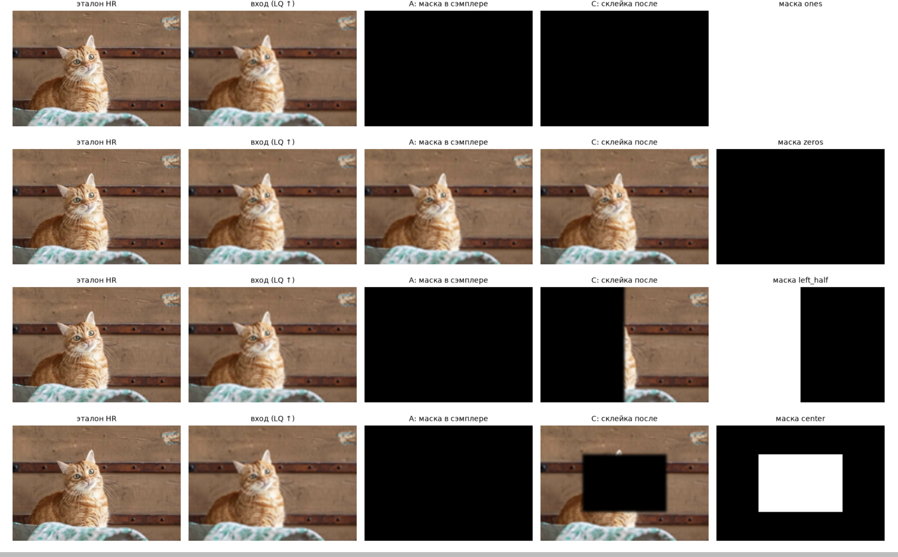

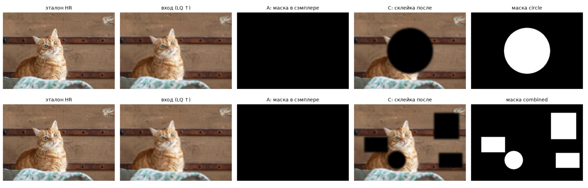

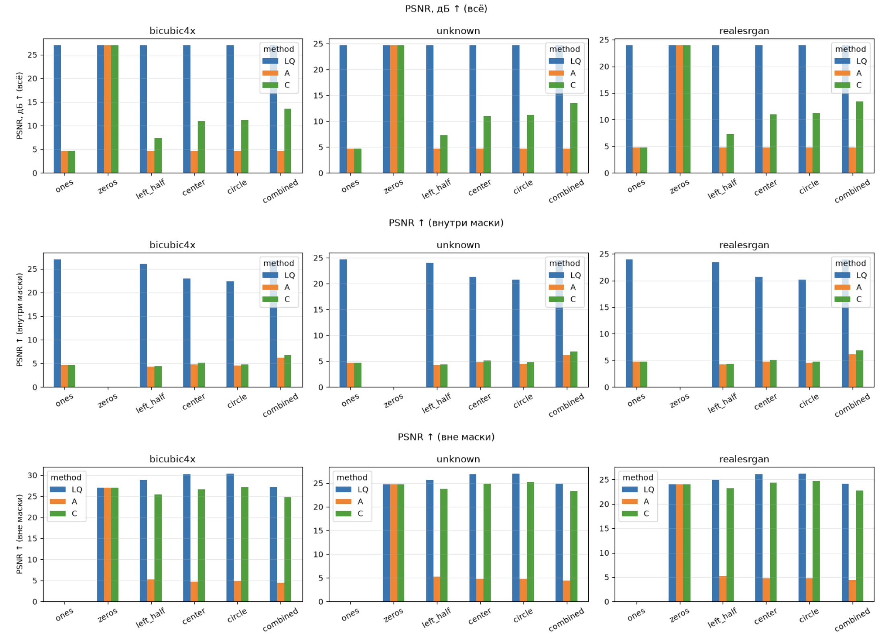

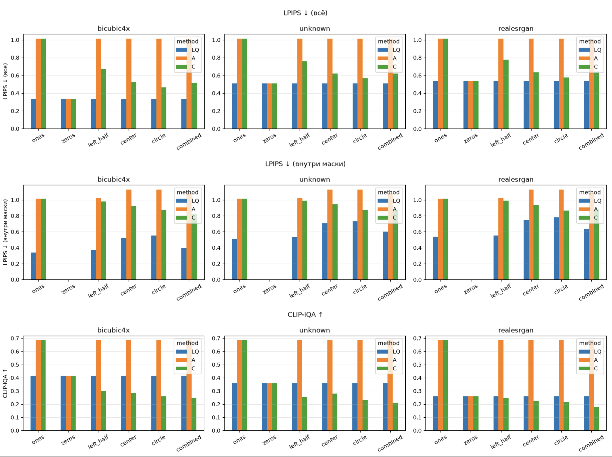

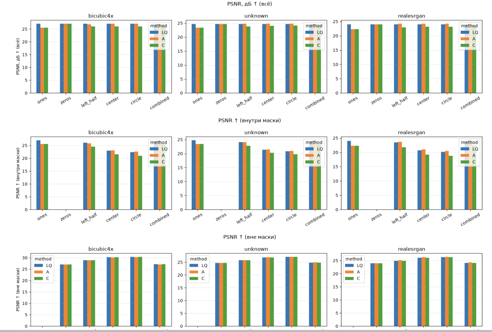

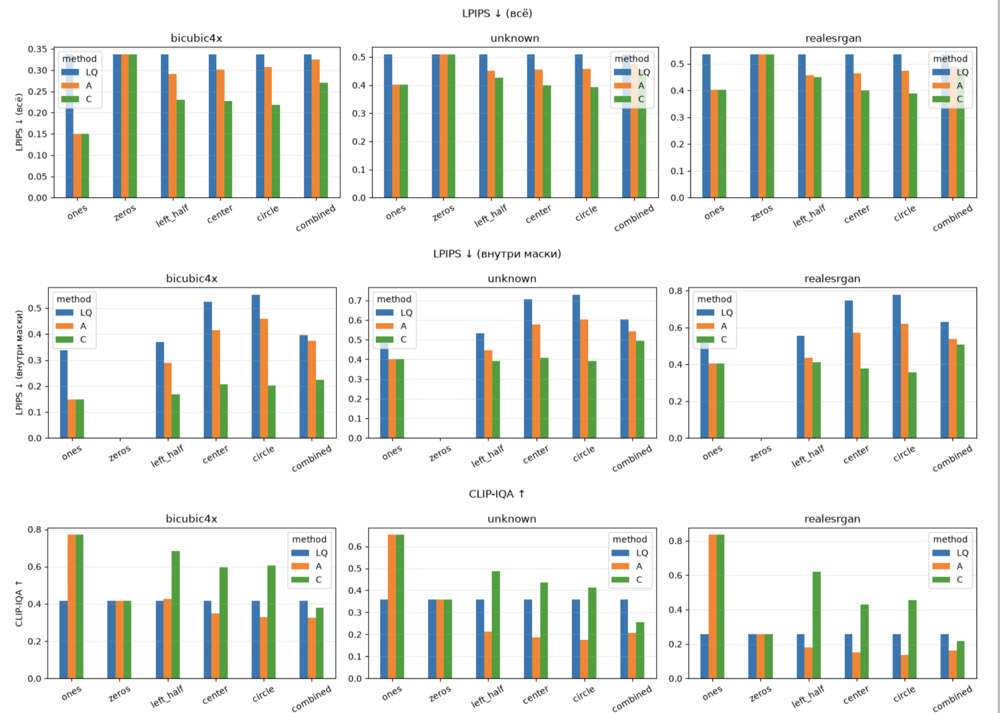

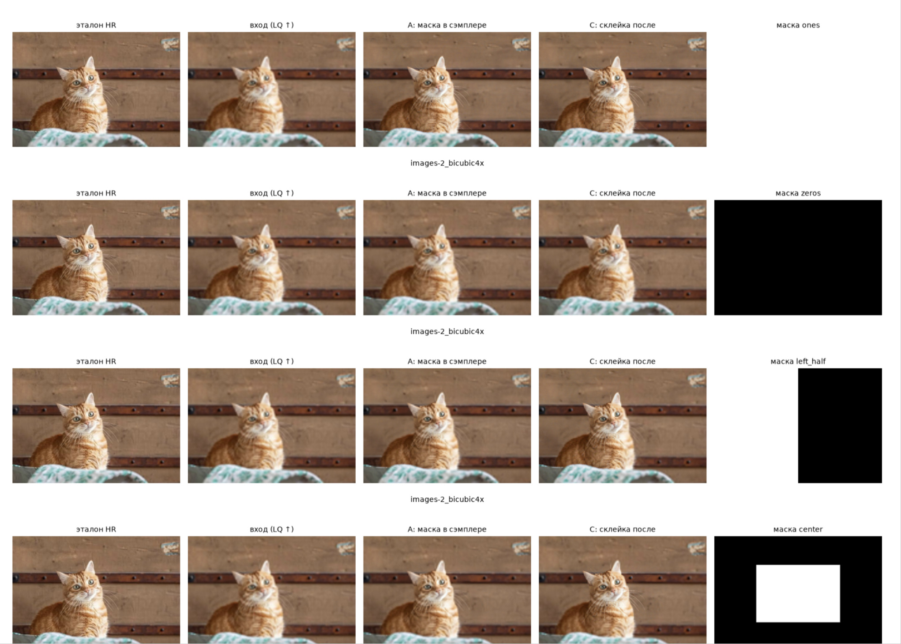

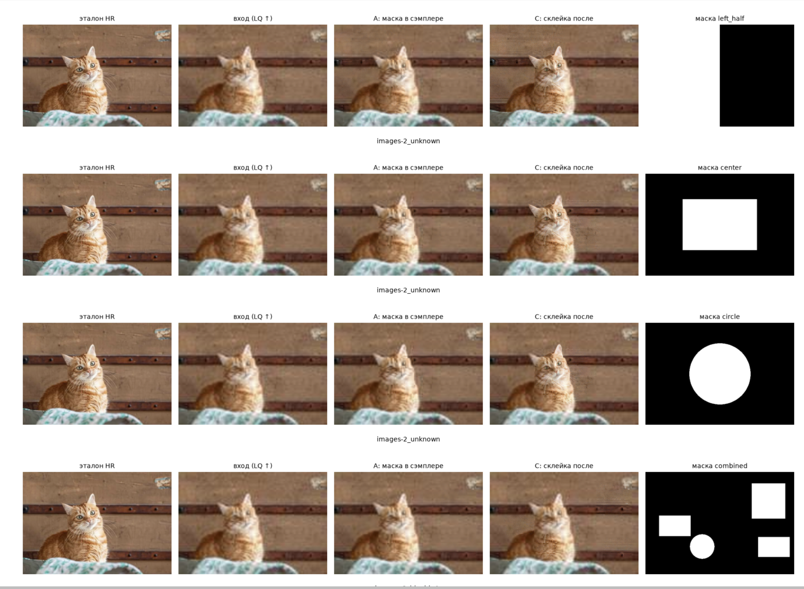

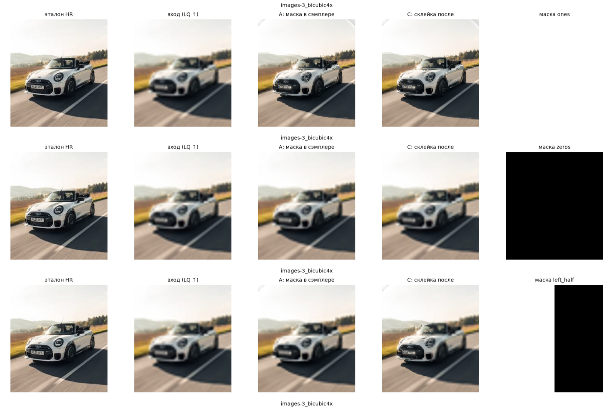

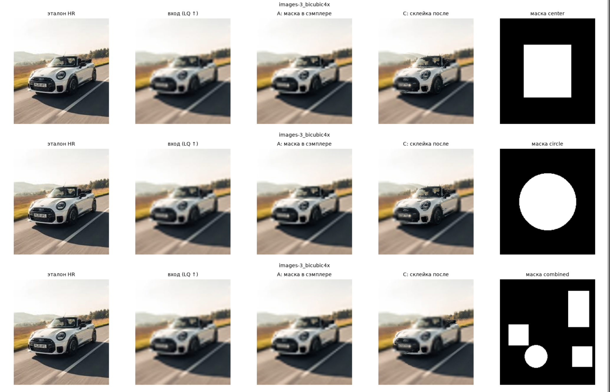

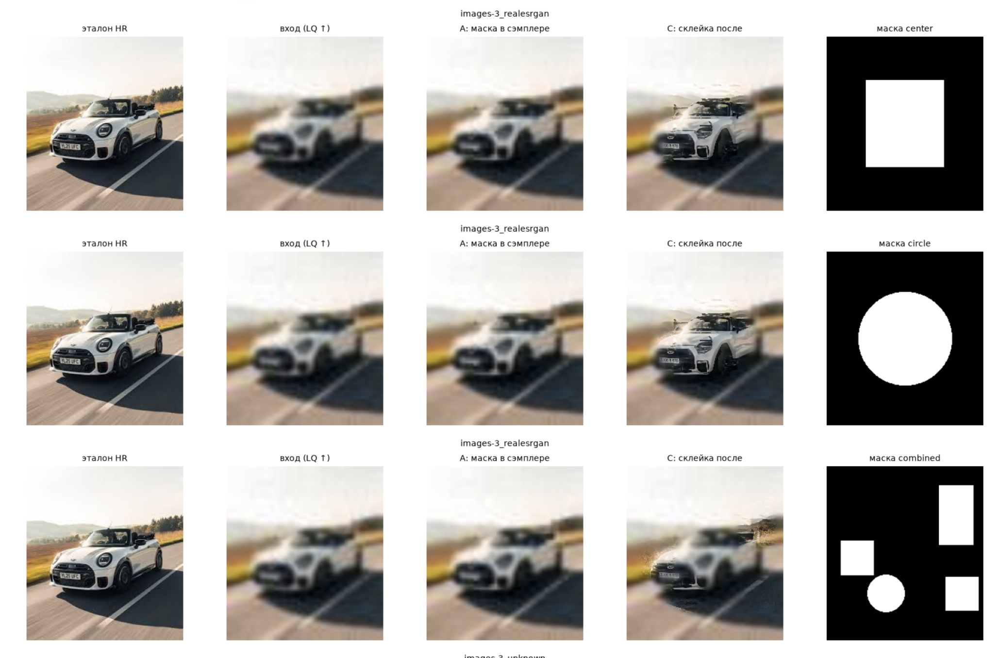

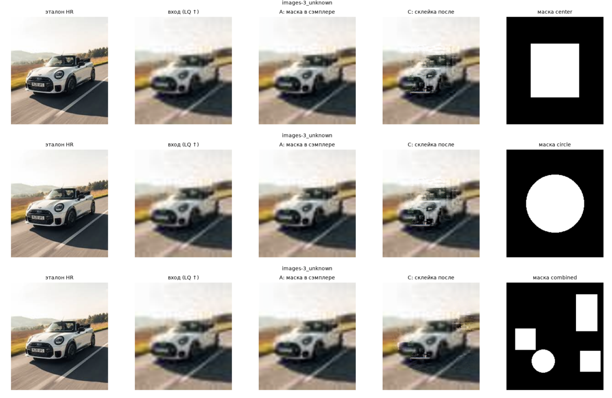

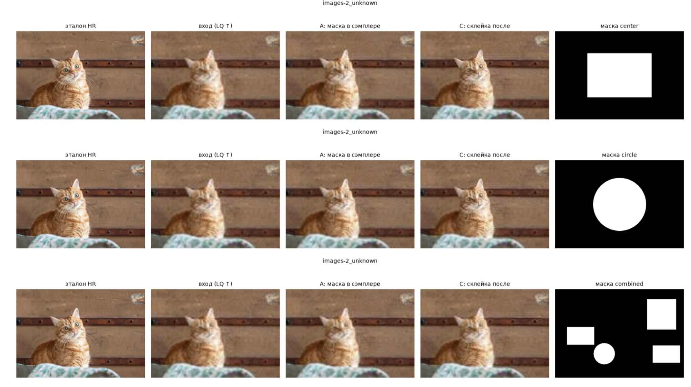

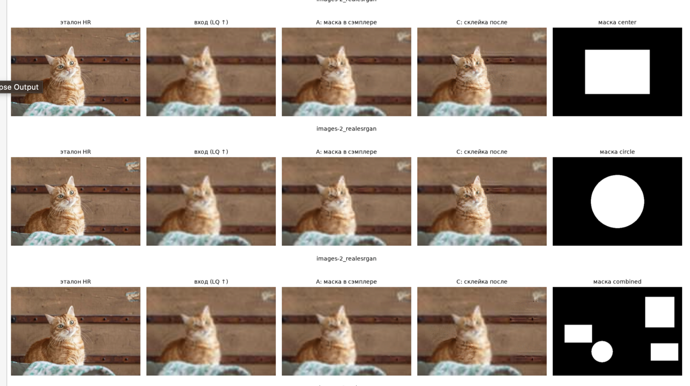

---

